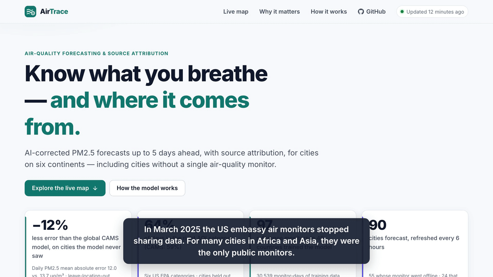
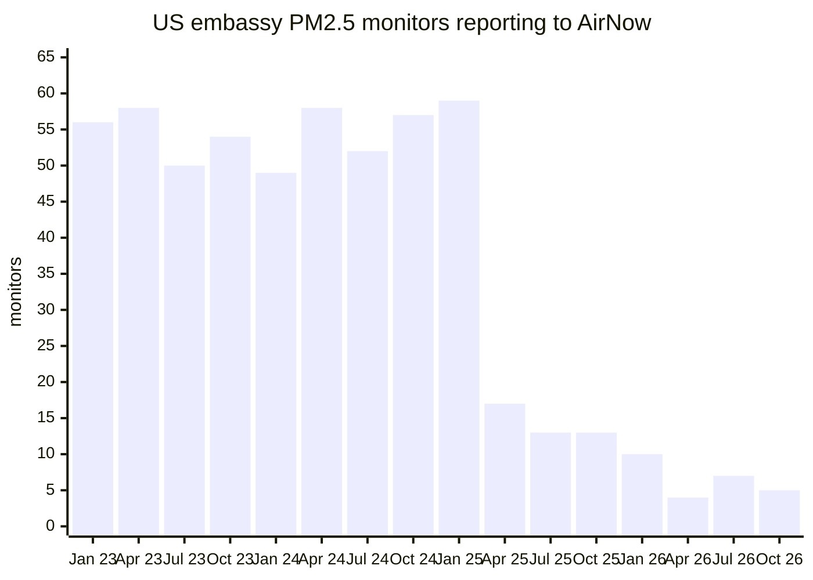
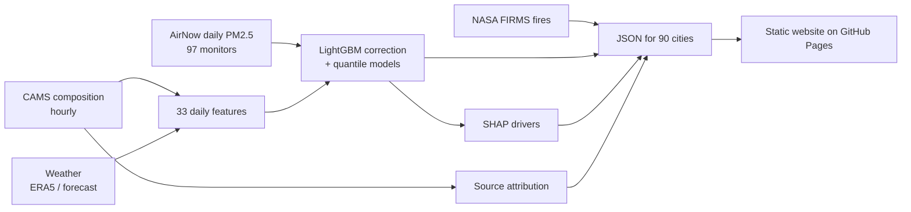
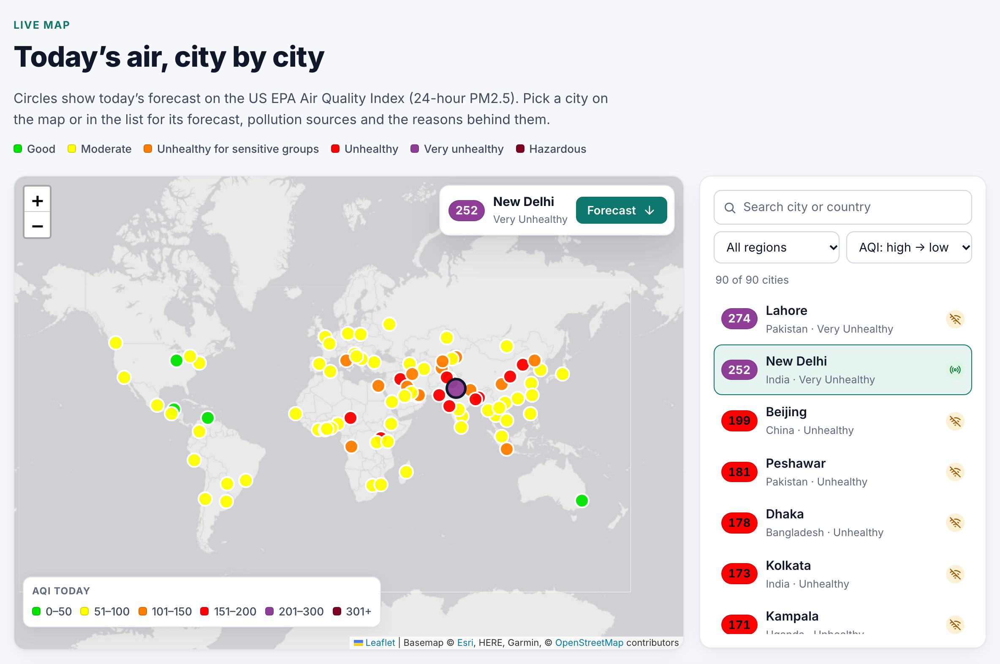
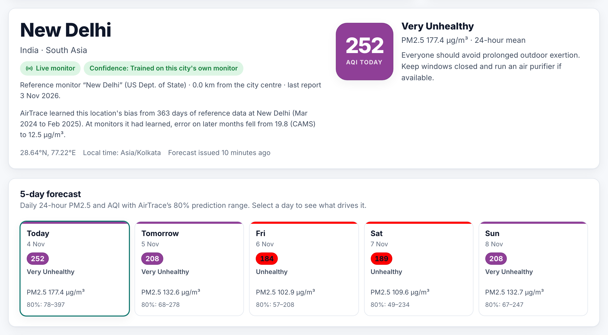
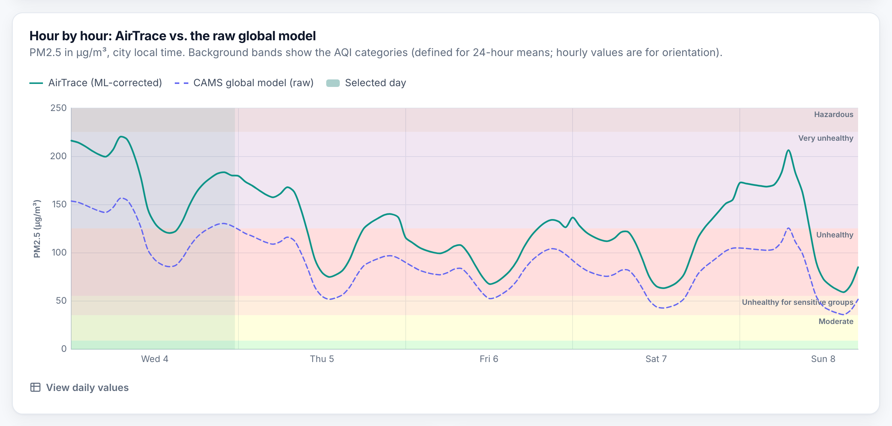
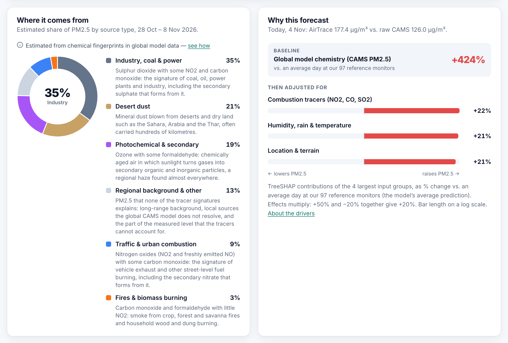
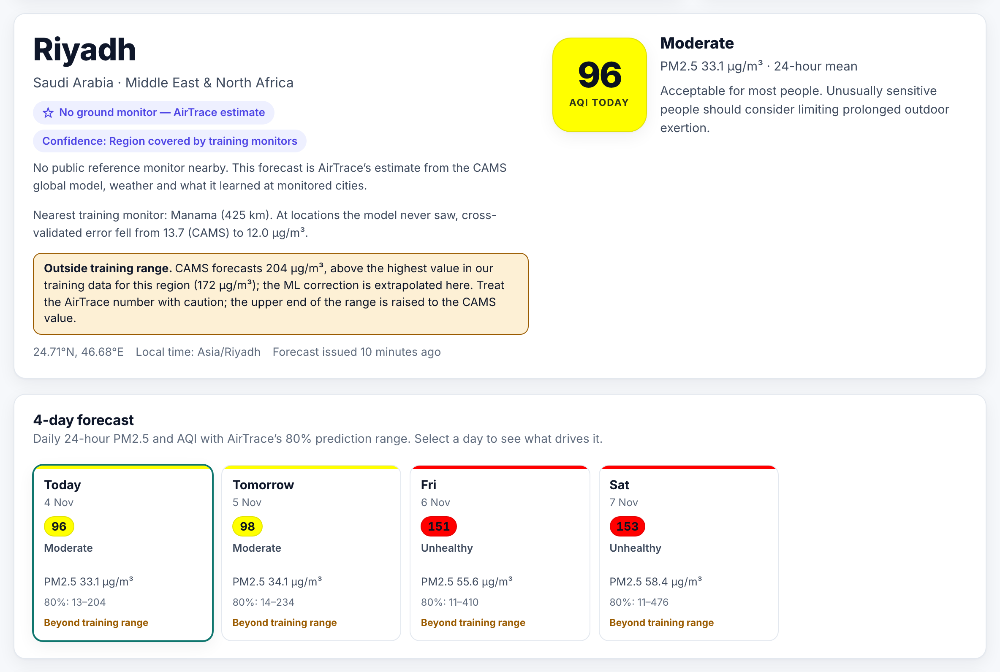
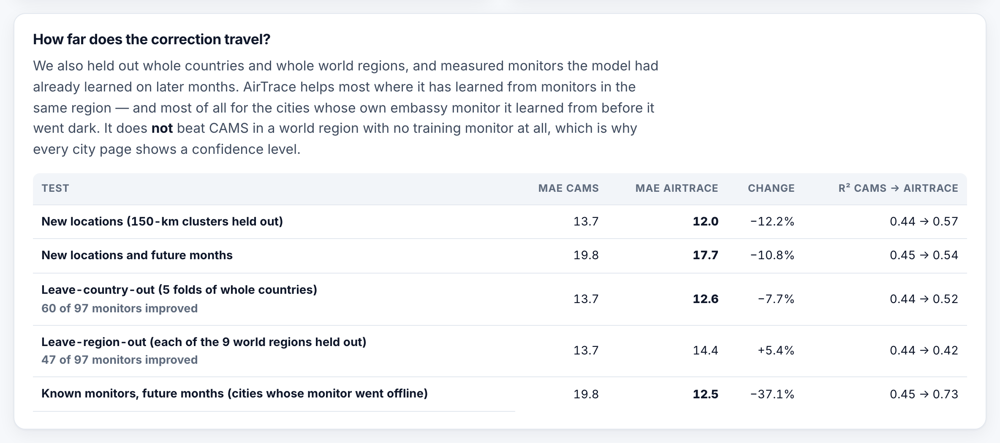
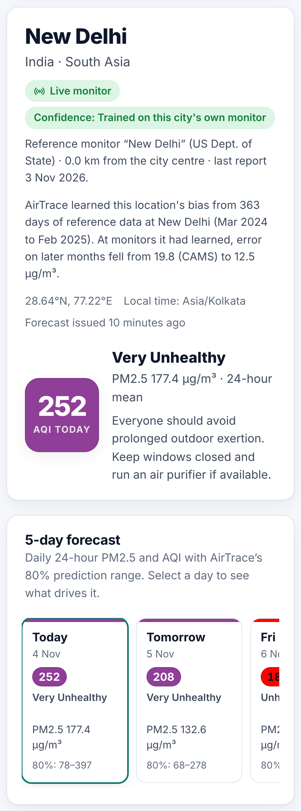

# AirTrace

PM2.5 forecasts and pollution source estimates for 90 cities, built by correcting the Copernicus CAMS
global model with machine learning. It keeps working for the cities that lost their only air monitor.

Live site: https://handue.github.io/airtrace/

- **Hackathon:** Neural Storm 2026
- **Track:** Green Planet
- **Problem statement:** GP-01, Air Quality Monitoring & Source Attribution
- **Team:** AirTrace (solo)
- **Member:** Hanju Jeong ([@handue](https://github.com/handue))



Full demo video with narration (100 s, 1080p): [docs/assets/demo.mp4](docs/assets/demo.mp4)

## Why I built this

A lot of cities in Africa and Asia have no public reference-grade PM2.5 monitor. For many of them the only
one was the monitor on the roof of the US embassy. On 4 March 2025 the State Department stopped sending that
data out, citing budget cuts ([CBS](https://www.cbsnews.com/news/state-department-stops-reporting-air-quality-levels),
[NBC](https://www.nbcnews.com/news/world/us-embassies-end-air-pollution-monitoring-spurred-china-others-action-rcna194825),
[CREA](https://energyandcleanair.org/us-embassy-aq-data-halt/)).

I counted the embassy monitors that still report PM2.5 in AirNow's public daily files, sampling the 15th of each month:



The count went from 59 in January 2025 to 5 in October 2026.

Global models like CAMS still give a number for every city, but they are often far off where there are no
monitors. In my training data, CAMS underestimates daily PM2.5 by 23 µg/m³ on average in South Asia and by
20 µg/m³ in Sub-Saharan Africa. The idea behind AirTrace: learn the bias from the monitors while they still
existed, and keep correcting the forecast after they went dark.

## What it does

- Daily PM2.5 / US AQI forecast for today and up to 4 more days, for 90 cities, with an 80% range.
- Explains each forecast: which inputs (weather, combustion gases, dust, season, location) pushed it up or down.
- Estimates where the PM2.5 comes from: traffic, industry & coal, fires & biomass burning, desert dust,
  photochemical/secondary aerosol, sea salt and background.
- Shows active fires within 300 km (NASA FIRMS) and which ones are upwind.
- Shows a confidence level per city (trained on the city's own monitor / region covered / outside training
  coverage), and warns when CAMS predicts values above anything in the training data.
- Rebuilds itself every 6 hours with GitHub Actions. Everything runs on free data that needs no API keys.

## How it works



**Training data.** Daily PM2.5 from AirNow's public files for March 2024 to February 2025, the last full
year before the embassy network collapsed. That is 61 embassy monitors (Asia, Africa, Middle East, Latin
America, Balkans) plus 36 monitors spread across the US and Canada: 97 monitors in 49 countries, 30,539
monitor-days. For each site I pulled hourly CAMS composition and ERA5 weather from Open-Meteo.

**Features** (`airtrace/features.py`, the same code is used for training and for the live site). Hourly data
is aggregated to local days: CAMS PM2.5 (mean, night mean, max, change from yesterday), PM10, dust, AOD, CO,
NO2, SO2, O3, a few ratios, temperature and its daily range, humidity, rain, pressure, wind, sunlight, season,
weekday, latitude, longitude and elevation.

Two things I dropped on purpose:
- **Mixing height.** The archive has no values before July 2024. An ablation showed the model is not worse without it.
- **NO, formaldehyde and sea salt.** These only start in September 2024. Their missing values would line up
  with the season, so they are only used for source attribution.

**Model** (`airtrace/model.py`). LightGBM on log PM2.5, as the average of two members:
- one that predicts the level directly;
- one that predicts the correction to CAMS (log ratio).

It is constrained to increase with CAMS PM2.5, and every monitor gets the same total weight, so the 36
cleaner North American sites don't dominate. Two quantile models plus a conformal correction give the 80% range.

**Validation.** Monitors are grouped into clusters (any two monitors closer than 150 km end up in the same
cluster) and whole clusters are held out with GroupKFold. So every score below is for a place with no
training monitor within 150 km. I first used 1° grid cells and got a better-looking −17%, but neighbouring
cells let nearby monitors leak into training (Los Angeles and Riverside, Dubai and Abu Dhabi), so I switched.

## Results

All numbers come from `scripts/05_train_evaluate.py` and are stored in
[`docs/data/metrics.json`](docs/data/metrics.json), which the website also reads.

### Held-out locations (30,539 monitor-days)

| Model | MAE (µg/m³) | RMSE | R² | AQI category accuracy | Recall on "unhealthy" days |
|---|---:|---:|---:|---:|---:|
| CAMS (raw) | 13.65 | 27.33 | 0.44 | 59.0% | 51.4% |
| CAMS + linear calibration | 14.07 | 28.35 | 0.40 | 56.6% | 49.3% |
| ML without CAMS | 12.98 | 26.58 | 0.47 | 60.3% | 60.4% |
| **AirTrace** | **11.98** | **23.93** | **0.57** | **64.3%** | **66.3%** |

- **Error:** about 12% lower MAE and RMSE than CAMS. AirTrace is better at 70 of the 97 monitors.
- **Calibration:** the 80% range covers 79.9% of held-out days overall. It covers only about 63% of the
  very polluted days (≥ 55.5 µg/m³), so the range is too narrow exactly when it matters most.

### By region

| Region | Monitors | MAE CAMS → AirTrace | Bias CAMS → AirTrace |
|---|---:|---:|---:|
| South Asia | 12 | 27.4 → 22.6 | −23.4 → −3.0 |
| East Asia | 5 | 24.7 → 16.8 | +13.3 → +2.1 |
| Middle East & North Africa | 9 | 17.3 → 14.2 | +1.3 → −4.7 |
| Sub-Saharan Africa | 13 | 23.2 → 21.6 | −19.5 → −11.9 |
| Central Asia & Caucasus | 7 | 16.9 → 16.9 | −13.9 → −3.6 |
| North America | 36 | 4.4 → 3.5 | +0.3 → −0.6 |
| Southeast Asia | 5 | 13.0 → 14.0 | −0.5 → +8.2 |
| Latin America & Caribbean | 7 | 8.4 → 8.9 | −1.5 → −0.8 |
| Europe (Balkans) | 3 | 21.1 → 23.7 | −18.0 → −10.6 |

- **Where it helps:** it mostly fixes the large underestimate in South Asia and Central Asia, and halves it in Africa.
- **Where it doesn't:** it is worse than CAMS for the small Southeast Asian, Latin American and Balkan groups.

### How far the correction travels

| Test | MAE CAMS | MAE AirTrace | Change |
|---|---:|---:|---:|
| New locations (150 km clusters held out) | 13.65 | 11.98 | −12.2% |
| New locations and future months (train Mar–Nov 2024, test Dec–Feb) | 19.80 | 17.66 | −10.8% |
| Whole countries held out | 13.65 | 12.60 | −7.7% |
| A whole world region held out | 13.65 | 14.39 | +5.4% |
| Known monitors, future months | 19.80 | 12.46 | −37.1% |

The last row is the situation of the 55 cities on the site whose embassy monitor went offline: the model
learned that monitor's bias before it stopped. The second-to-last row is the main limitation. With no
training monitor anywhere in a region, the correction does not beat CAMS. That's why each city page shows a
confidence level: 62 of the 90 cities were trained on their own monitor, 20 are in a covered region, and 8
(London, Tokyo and Sydney among them) are outside training coverage.

### Check on new 2026 data

Every refresh compares the last 7 days with AirNow observations at the cities whose monitor still reports.
These days are unseen, since the model was trained on 2024–25. They are built from the same short-range CAMS
data and analysed weather the site uses for "today", so this measures nowcasting, not day-3 forecasts.

- **Overall:** for 28 Oct – 3 Nov 2026 (10 cities, 65 city-days), MAE went from 15.8 (CAMS) to 9.7 µg/m³ (AirTrace).
- **Example, New Delhi on 3 Nov:** measured 233, CAMS 118, AirTrace 180 µg/m³.

### Ablations

All with held-out 150 km clusters.

| Variant | MAE |
|---|---:|
| level member, no weights or constraints | 11.83 |
| + equal weight per monitor | 11.97 |
| + monotone in CAMS PM2.5 | 11.91 |
| + location split penalty | 11.99 |
| ratio member only | 12.18 |
| average of level and ratio (deployed) | 11.98 |

The differences are smaller than the fold-to-fold noise (about ±0.3). I kept the configuration chosen
earlier instead of picking the best row after looking at the test folds.

## Source attribution

`airtrace/sources.py` uses a chemical mass balance model.

1. **Tracers.** Eight daily CAMS tracers are scaled by their 90th percentile: NO2, NO, CO, SO2, O3,
   formaldehyde, dust and sea salt.
2. **Source profiles.** Non-negative least squares splits the tracers into six fixed profiles:
   - traffic: NO2 + NO + some CO
   - industry & coal: SO2
   - burning: CO + formaldehyde
   - photochemical/secondary: O3 + formaldehyde
   - dust
   - sea salt
3. **PM2.5 per source.** This is fitted against CAMS PM2.5 first (within each site), then calibrated to
   measured PM2.5 at 96 monitors. The calibration intercept becomes the "background & other" slice.

Before this I tried NMF and PMF-style factorisation. They kept pushing traffic or sea salt to zero
everywhere, so I switched to fixed profiles. I wrote down five sanity checks before fitting:

| Check | Result |
|---|---|
| Sea salt share higher at coastal monitors | pass (0.032 vs 0.001) |
| Dust share highest in the Middle East, North Africa and Sahel | pass (0.21 vs 0.07 next) |
| Traffic higher on weekdays | fail (CAMS NO2 has no weekly cycle) |
| Burning peaks in Delhi/Lahore in Oct–Nov | fail (CAMS CO peaks in Dec–Jan) |
| Explains observed PM2.5 with R² > 0.3 | fail (0.17, 0.11 at unseen locations) |

Some examples:
- **New Delhi, Oct–Nov:** industry & coal 41%, secondary 21%, traffic 16%, background 12%, dust 6%, burning 4%.
- **N'Djamena:** 48% dust.
- **Los Angeles:** 60% traffic.

Burning in Delhi is lower than filter-based studies report (around 15–25%). The tracers are ~40 km grid
averages that come from emission inventories. So the shares are rough fingerprints, and the site says that
next to the chart.

## Tech stack

- **Python:** pandas, NumPy, PyArrow, requests, LightGBM (boosting, quantile regression, TreeSHAP),
  scikit-learn, SciPy.
- **Data:** Copernicus CAMS and ERA5 via Open-Meteo, AirNow (US EPA / US State Department), NASA FIRMS.
- **Website:** plain HTML/CSS/JavaScript with Leaflet 1.9.4 and Chart.js 4.4.1, on GitHub Pages.
- **Automation:** GitHub Actions, pytest.

## Setup

Requirements:
- Python 3.12 or newer (I used 3.14).
- On macOS, OpenMP for LightGBM: `brew install libomp`.
- No API keys.

```bash
git clone https://github.com/handue/airtrace.git
cd airtrace
python3 -m venv .venv
source .venv/bin/activate
pip install -r requirements.txt
```

## Running locally

The trained models (`models/`) and the processed training table (`data/processed/`) are in the repo, so you
can rebuild the site data and open it right away:

```bash
python scripts/08_build_site_data.py          # fetches today's forecasts for 90 cities (~25 s)
python -m http.server 8000 --directory docs   # then open http://localhost:8000
```

Other targets:

```bash
make train      # cross-validation, ablations, final models, docs/data/metrics.json (~2 min)
make sources    # source attribution model
make test       # pytest
make all        # everything from the raw downloads
```

`make all` uses about 6,000 of Open-Meteo's 10,000 free daily calls.

## Screenshots

Map of today's forecast for all 90 cities:



City page with the confidence level and 5-day forecast:



Hourly curve against the raw global model:



Source shares and what drives the forecast:



Warning when CAMS goes beyond the training range (Riyadh dust):



How far the correction travels, from the methods page:





## Project layout

```
airtrace/     features, model, dataset, sources, live site builder, AirNow / FIRMS / Open-Meteo clients
scripts/      01-09: download, select sites, build dataset, train, sources, history, site data
config/       training monitors (97) and the 90 cities on the site
models/       trained LightGBM files and the source model
data/         processed training table and cross-validation predictions (raw downloads are not committed)
docs/         the website, its JSON data and screenshots
tests/        pytest
```

`DATA_CONTRACT.md` describes the JSON files the site reads.

## Data sources and credits

- **CAMS and ERA5:** Copernicus Atmosphere Monitoring Service and ERA5 reanalysis, accessed through
  [Open-Meteo](https://open-meteo.com/) (CC BY 4.0). Contains modified Copernicus Atmosphere Monitoring
  Service information 2024–2026.
- **AirNow:** public data files from the US EPA, including US State Department embassy monitors. The data
  are preliminary.
- **NASA FIRMS:** VIIRS (Suomi NPP) active fire detections.
- **Basemap:** © Esri, HERE, Garmin, © OpenStreetMap contributors.

## Limitations

- **Not medical advice.** It's a prototype, so follow your local official advisories.
- **Training coverage:** one year of data at 97 monitors, with few in Africa, Europe and Latin America.
- **Forecast vs. training inputs:** training used archived CAMS and reanalysis weather, while the site uses
  real forecasts. Accuracy on days 3–5 is probably lower than the numbers above.
- **Hourly values:** the model predicts daily means. The hourly curve on the site is the CAMS hourly
  shape scaled to the AirTrace daily value.
- **Source shares** are estimates from model chemistry, not measurements.

## AI tools used

I used Claude Code (Anthropic's AI coding assistant) heavily during the hackathon. It was used for:
- writing most of the code;
- running and checking experiments;
- drafting this README.

The narration in the demo video is an AI voice (Kokoro-82M, an open-source text-to-speech model run
locally). The background music was generated in Python for this project, so it has no copyright issues.

The work was done under my direction. Every number above comes from the scripts in this repo and can be
reproduced.

## License

MIT, see [LICENSE](LICENSE).
