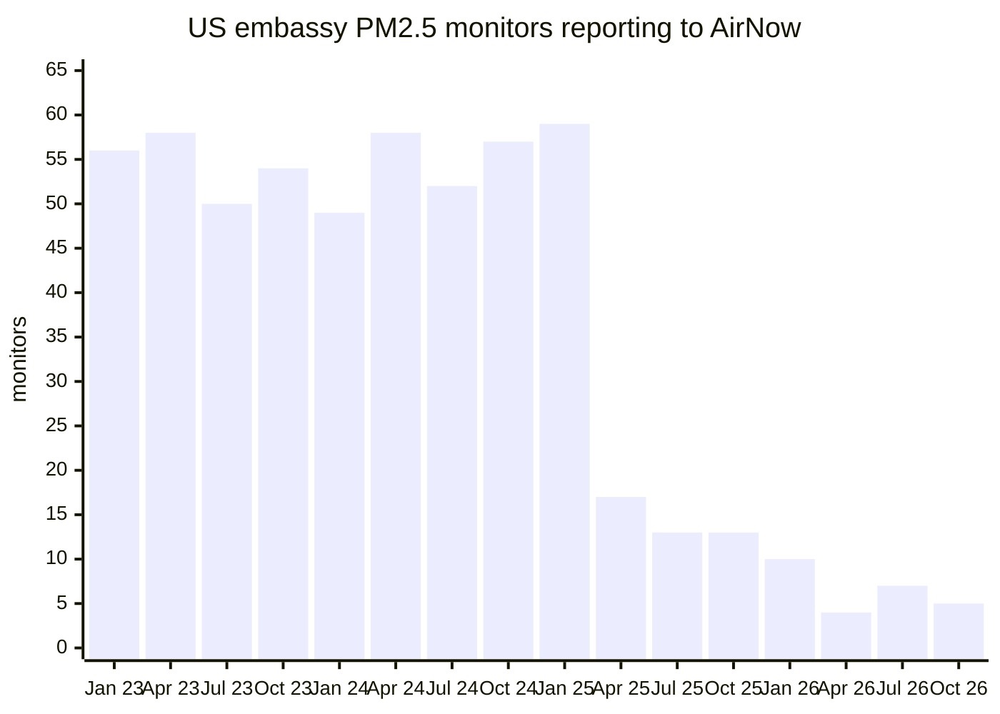
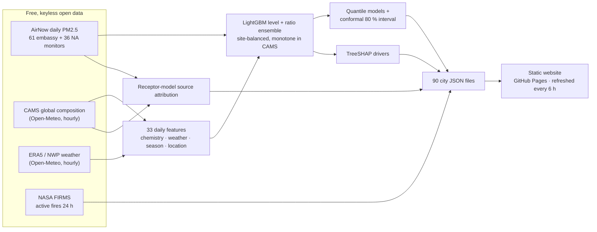

# AirTrace — know what you breathe, and where it comes from

**AI-corrected 5-day PM2.5 forecasts and pollution source attribution for 90 cities on six continents — including the cities whose only air-quality monitor was switched off.**

[](https://handue.github.io/airtrace/)


| | |
|---|---|
| **Hackathon** | Neural Storm 2026 |
| **Track** | Green Planet — Sustainability & Environmental Intelligence |
| **Problem statement** | **GP-01 · Air Quality Monitoring & Source Attribution** |
| **Team** | Team AirTrace |
| **Member** | Hanju Jeong ([@handue](https://github.com/handue)) |
| **Live demo** | **https://handue.github.io/airtrace/** (refreshed every 6 hours by GitHub Actions) |


---

## Contents
[The problem](#the-problem) · [Our solution](#our-solution) · [Results](#results) · [How it works](#how-it-works) ·
[Source attribution](#source-attribution) · [Tech stack](#technology-stack) · [Setup](#setup--installation) ·
[Run locally](#running-locally) · [Screenshots](#screenshots) · [Repository](#repository-structure) ·
[Data & credits](#data-sources--credits) · [Limitations](#limitations--responsible-ai) · [AI tools](#ai-tools-disclosure)

## The problem

Air pollution is linked to about **7 million premature deaths a year** (WHO), and 99 % of people breathe air
above the WHO guideline. Yet most cities in Africa, South Asia and Central Asia have **no public
reference-grade PM2.5 monitor**. For dozens of them the only one was the **US embassy monitor** — and on
4 March 2025 the US Department of State stopped transmitting embassy air-quality data, citing budget
constraints ([CBS News](https://www.cbsnews.com/news/state-department-stops-reporting-air-quality-levels),
[NBC News](https://www.nbcnews.com/news/world/us-embassies-end-air-pollution-monitoring-spurred-china-others-action-rcna194825));
CREA estimated that this weakened monitoring in 44 countries and left six with none at all
([CREA](https://energyandcleanair.org/us-embassy-aq-data-halt/)). Counting the embassy monitors that report
PM2.5 in AirNow's public daily files (we sampled the 15th of every month):



**59 monitors in January 2025 → 5 in October 2026.** Global atmospheric models such as Copernicus CAMS
cover every city, but they are badly biased exactly where monitors are missing — in our data CAMS
**underestimates PM2.5 by 23 µg/m³ on average in South Asia and by 20 µg/m³ in Sub-Saharan Africa**.

People in those cities need two answers: *how bad will the air be this week?* and *where is it coming from?*

## Our solution

AirTrace learns from the ground truth while it existed and keeps forecasting after the monitors went dark:

1. **Forecast** — a LightGBM model corrects the CAMS global forecast with 33 physics-aware daily features
   (CAMS chemistry, weather, season, location). It was trained on **97 reference monitors in 49 countries**
   (61 US-embassy monitors across Asia, Africa, the Middle East, Latin America and Europe + 36 North American
   monitors) and validated **only on locations it never saw**.
2. **Uncertainty & honesty** — every forecast comes with a calibrated **80 % interval** (quantile models +
   conformal correction), a **confidence level** for the city (trained on its own monitor / region covered
   / outside training coverage) and a warning when CAMS forecasts values beyond anything in training.
3. **Explain** — TreeSHAP turns each forecast into plain-language drivers ("weather: +38 %", "combustion tracers: +24 %").
4. **Attribute** — a receptor model on eight CAMS chemical tracers estimates the share of traffic, industry &
   coal, fires & biomass burning, desert dust, photochemical/secondary aerosol, sea salt and background.
5. **Context** — NASA FIRMS fires within 300 km (flagging the upwind ones) and live AirNow observations
   where a monitor still exists.
6. **Ship** — a static website for 90 cities that a GitHub Action rebuilds every 6 hours from free, keyless data.

## Results

All numbers below are produced by `scripts/05_train_evaluate.py` and stored in
[`docs/data/metrics.json`](docs/data/metrics.json); the website reads the same file.

### Leave-location-out cross-validation (30,539 monitor-days, 97 monitors, 49 countries)
GroupKFold(5) over 91 spatial clusters — any two monitors closer than 150 km are held out together, so every
prediction is for a place with no training monitor within 150 km.

| Model | MAE µg/m³ | RMSE µg/m³ | R² | Bias | AQI category accuracy | "Unhealthy" day recall | F1 |
|---|---:|---:|---:|---:|---:|---:|---:|
| CAMS global model (raw) | 13.65 | 27.33 | 0.441 | −5.84 | 59.0 % | 51.4 % | 0.599 |
| CAMS + weighted linear calibration | 14.07 | 28.35 | 0.399 | −5.61 | 56.6 % | 49.3 % | 0.579 |
| ML without CAMS (weather + location) | 12.98 | 26.58 | 0.471 | −3.84 | 60.3 % | 60.4 % | 0.645 |
| **AirTrace (CAMS + ML correction)** | **11.98** | **23.93** | **0.571** | **−2.45** | **64.3 %** | **66.3 %** | **0.690** |

**−12.2 % MAE and −12.4 % RMSE versus CAMS at locations the model never saw; the AQI category is right on
64.3 % of days (CAMS 59.0 %) and AirTrace catches 66.3 % of "unhealthy for sensitive groups or worse" days
(CAMS 51.4 %).** AirTrace beats CAMS at 70 of the 97 held-out monitors.
(With the looser 1° grid-cell grouping we first used, the gain looked like −17 %; an internal review showed
nearby monitors in neighbouring cells, so we report the stricter number.)

The 80 % prediction interval covers **79.9 %** of held-out observations (mean width 35.4 µg/m³). Coverage is
not uniform: 82.6 % on days below 35.5 µg/m³ but **63.4 % on "Unhealthy" days** (≥ 55.5 µg/m³), and 22 of
97 monitors are below 70 %.

### Where it helps (out-of-fold, by region)

| Region | Monitors | MAE CAMS → AirTrace | Bias CAMS → AirTrace |
|---|---:|---:|---:|
| South Asia | 12 | 27.4 → **22.6** | −23.4 → **−3.0** |
| East Asia | 5 | 24.7 → **16.8** | +13.3 → **+2.1** |
| Middle East & North Africa | 9 | 17.3 → **14.2** | +1.3 → −4.7 |
| Sub-Saharan Africa | 13 | 23.2 → **21.6** | −19.5 → **−11.9** |
| Central Asia & Caucasus | 7 | 16.9 → 16.9 | −13.9 → **−3.6** |
| North America | 36 | 4.35 → **3.54** | +0.3 → −0.6 |
| Southeast Asia | 5 | 13.0 → 14.0 | −0.5 → +8.2 |
| Latin America & Caribbean | 7 | 8.4 → 8.9 | −1.5 → −0.8 |
| Europe (Balkans) | 3 | 21.1 → 23.7 | −18.0 → −10.6 |

AirTrace removes most of CAMS' low bias in South Asia, East and Central Asia and halves it in Africa. It is
worse than CAMS for the small Southeast-Asian, Latin-American and Balkan groups — we report that rather than hide it.

### How far does the correction travel?

| Test (all out-of-sample) | MAE CAMS | MAE AirTrace | Change | R² CAMS → AirTrace |
|---|---:|---:|---:|---:|
| New locations (150-km clusters held out) | 13.65 | **11.98** | −12.2 % | 0.44 → 0.57 |
| New locations **and** future months (train Mar–Nov 2024, test Dec 2024–Feb 2025) | 19.80 | **17.66** | −10.8 % | 0.45 → 0.54 |
| Leave-country-out (whole countries held out; 60 of 97 monitors improve) | 13.65 | **12.60** | −7.7 % | 0.44 → 0.52 |
| Leave-region-out (a whole world region held out; 47 of 97 improve) | 13.65 | 14.39 | **+5.4 %** | 0.44 → 0.42 |
| Known monitors, future months — *the situation of the 55 cities whose embassy monitor went offline* | 19.80 | **12.46** | **−37.1 %** | 0.45 → 0.73 |

The correction transfers to new cities and countries inside the regions our 97 monitors cover, works best for
cities whose own monitor it learned from, and does **not** transfer to a world region with no training monitor.
That is why every city page shows a confidence level: **62 of the 90 cities** are "trained on this city's own
monitor", 20 are "region covered by training monitors" and 8 (e.g. London, Tokyo, Sydney) are
"outside training coverage".

### Live hindcast check on brand-new 2026 data
Every refresh compares the last 7 days of AirTrace and CAMS daily values (built from the same short-lead CAMS
fields and analysed weather that the site uses for "today") with AirNow observations at cities whose monitor
still reports. The model was trained on 2024-25, so these days are unseen. At submission time (window
2026-10-28 → 2026-11-03, 10 cities with ≥3 observed days, 65 city-days): **MAE CAMS 15.8 → AirTrace 9.7 µg/m³
(−39 %)**, bias −10.1 → −2.6. Example — New Delhi, 3 Nov 2026: observed **233**, CAMS **118**, AirTrace
**180** µg/m³. (Most of these cities are training monitors, so this is the "known monitor, future months"
situation; it says nothing yet about day-3-to-5 forecast skill.)

### Ablations (leave-location-out, 150-km clusters)
| Variant | MAE |
|---|---:|
| level member, unweighted, unconstrained | 11.83 |
| + site-balanced weights | 11.97 |
| + monotone in CAMS PM2.5 | 11.91 |
| + location split penalty (deployed level member) | 11.99 |
| ratio member (CAMS log-offset + ML correction) | 12.18 |
| **AirTrace = mean of level and ratio members (deployed)** | **11.98** |
| with mixing-height features (archive lacks them before Jul 2024; 1° grouping) | 11.34 vs 11.29 without → dropped |

Under the stricter grouping these variants differ by less than the fold-to-fold noise (about ±0.3 µg/m³), so we
kept the physically motivated configuration (monotone in CAMS, every monitor weighted equally) chosen earlier
rather than re-selecting on the test folds.

## How it works



**Ground truth.** AirNow publishes keyless daily files; we keep PM2.5 24-hour means with ≥18 valid hours
for Mar 2024–Feb 2025 — the last full year before the embassy network collapsed — at every embassy monitor with
≥100 valid days (one per city) plus 36 spatially spread North-American monitors.

**Features** (`airtrace/features.py`, shared by training and the live pipeline so they cannot drift):
hourly CAMS PM2.5/PM10/dust/AOD/CO/NO₂/SO₂/O₃ and ERA5 weather, aggregated to the local day — daily mean,
night mean and maximum PM2.5, day-over-day change, PM2.5/PM10, dust fraction, SO₂/CO, temperature and its
daily range, humidity, rain, pressure, wind vector and minimum wind, sunlight, season, weekday, latitude,
longitude and elevation. Three CAMS species that only exist from Sep 2024 (NO, HCHO, sea salt) are kept out
of the model (their missingness would be confounded with season) and used only for source attribution.

**Model** (`airtrace/model.py`): two LightGBM members on log PM2.5 — a *level* member and a *ratio* member that
predicts the correction to log CAMS — averaged in log space; monotone-increasing in CAMS PM2.5,
site-balanced sample weights (so 36 clean North-American sites do not dominate), a split penalty on location
features. Quantile members (10 %, 90 %) plus a leave-location-out conformal margin give the 80 % interval.

**Validation.** GroupKFold(5) over 150-km single-linkage monitor clusters, a new-locations-and-future-months
holdout, leave-country-out and leave-region-out tests, and the rolling live hindcast above. Baselines: raw CAMS,
a site-weighted linear log-log calibration of CAMS, and an ML model without CAMS. Every number above was
independently recomputed from `data/processed/cv_predictions.parquet` by a review script.

**Explanations.** LightGBM's built-in TreeSHAP (`pred_contrib`) gives per-feature contributions in log space;
we sum them into eight human-readable groups and report `exp(sum) − 1` as "+38 %"-style effects relative to an
average day across the training monitors.

**Live pipeline** (`airtrace/live.py`, `scripts/08_build_site_data.py`): for 90 cities it pulls 7 past + 5
forecast days of CAMS and weather (≈190 weighted Open-Meteo calls, ~25 s), builds the same features,
predicts today + up to 4 days, the hourly curve (CAMS hourly shape scaled to the AirTrace daily level), drivers,
source shares, fires within 300 km, the monitor status, the city's confidence level and out-of-range flags
(when CAMS exceeds the highest value seen in training for the region, e.g. a Riyadh dust event, the day is
flagged and the upper end of the interval is raised to the CAMS value), and writes JSON for the website.

## Source attribution

AirTrace estimates where PM2.5 comes from with a **receptor model by chemical mass balance (CMB)**
(`airtrace/sources.py`, `scripts/06_fit_sources.py`):

1. Eight daily CAMS tracers — NO₂, NO, CO, SO₂, O₃, formaldehyde, dust, sea salt — scaled by their 90th
   percentiles, are split by non-negative least squares into **six fixed reference source profiles** written
   from emission chemistry: traffic (NO₂ + NO + some CO), industry & coal (SO₂ + some NO₂/CO), fires & biomass
   burning (CO + HCHO), photochemical/secondary (O₃ + HCHO), desert dust, sea salt.
2. PM2.5 mass yields per source are fitted in two stages: a non-negative regression of CAMS PM2.5 on the source
   activations using within-site day-to-day variation (R² 0.57), then a calibration to **observed PM2.5 at 96
   reference monitors** (observed = 0.87 × modelled + 7.8 µg/m³). The constant is the
   *regional background & other* slice.
3. On the live site each day's contributions are scaled to that day's AirTrace PM2.5, so every slice is also
   given in µg/m³.

We tried five alternatives (NMF with free profiles, PMF-style NMF with PM mass as a species, constrained
profiles, yields fitted directly on observations); free factorisations kept collapsing traffic, sea salt or
background to zero, so we chose fixed profiles. Pre-stated plausibility checks, reported honestly:

| Check | Result | |
|---|---|---|
| Sea-salt share higher at coastal than inland monitors | 0.032 vs 0.001 | ✅ pass |
| Desert-dust share highest in Middle East / North Africa / Sahel | 0.211 vs next region 0.072 | ✅ pass |
| Traffic higher on working days than weekends | ratio 1.00 (CAMS NO₂ has no weekly cycle) | ❌ fail |
| Burning peaks in the Oct–Nov crop-residue season (Delhi, Lahore) | 0.72 (CAMS CO/HCHO peak in Dec–Jan) | ❌ fail |
| Source activations explain observed PM2.5 (target R² > 0.3) | 0.17 in-sample, 0.11 at unseen locations | ❌ fail |

Example shares: New Delhi in Oct–Nov — industry & coal 41 %, secondary 21 %, traffic 16 %, background 12 %,
dust 6 %, burning 4 %; N'Djamena (Sahel dry season) — dust 48 %; Los Angeles — traffic 60 %. Burning is too
low in Delhi compared with published filter-based studies (about 15–25 %) and traffic looks too high in
Beijing; the CAMS tracers are ~40 km grid averages built on emission inventories. **Treat the shares as
indicative fingerprints, not an emissions inventory** — the website says so next to every chart.

## Technology stack

| Layer | Tools |
|---|---|
| Language | **Python 3** for all data, ML and the live pipeline |
| Data | pandas, NumPy, PyArrow, requests |
| ML | LightGBM (gradient boosting, quantile regression, TreeSHAP), scikit-learn (GroupKFold), SciPy (NNLS, sparse graph clustering) |
| Data sources | Copernicus CAMS + ERA5 via Open-Meteo, AirNow (US EPA / US Dept. of State), NASA FIRMS |
| Website | HTML, CSS, vanilla JavaScript, Leaflet 1.9.4, Chart.js 4.4.1, CARTO basemap |
| Ops | GitHub Actions (scheduled refresh) + GitHub Pages, pytest |

## Setup & installation

Requirements: Python 3.11+ (developed on 3.14), macOS or Linux. LightGBM on macOS needs OpenMP
(`brew install libomp`). No API keys are needed.

```bash
git clone https://github.com/handue/airtrace.git
cd airtrace
python3 -m venv .venv && source .venv/bin/activate
pip install -r requirements.txt
```

## Running locally

The trained models (`models/`) and processed training data (`data/processed/`) are committed, so the site can
be refreshed and served in under a minute:

```bash
python scripts/08_build_site_data.py          # live forecasts for 90 cities -> docs/data (~25 s)
python -m http.server 8000 --directory docs   # open http://localhost:8000
```

Re-run the evaluation or the whole pipeline:

```bash
make train      # leave-location-out CV, ablations, final models, docs/data/metrics.json (~1.5 min)
make sources    # source attribution model + docs/data/sources_global.json
make test       # pytest: AQI maths, feature engineering, data contracts
make all        # everything from raw downloads (uses ~6,000 of Open-Meteo's 10,000 free daily calls)
```

## Screenshots

| Live map of 90 cities | City forecast, confidence level, hourly curve |
|---|---|
|  |  |

| Model card (methods page) | Mobile |
|---|---|
|  |  |

Landing page: [`docs/assets/screenshots/hero.png`](docs/assets/screenshots/hero.png). Regenerate all images with
`scripts/capture_screenshots.sh` while `python -m http.server 8765 --directory docs` is running.

## Repository structure

```
airtrace/            Python package
  features.py        hourly -> daily features (shared by training and live)
  model.py           LightGBM ensemble, CV, conformal intervals, metrics, SHAP
  dataset.py         training table (AirNow obs + CAMS + ERA5)
  sources.py         receptor-model source attribution
  live.py            builds every JSON file the website reads
  fires.py           NASA FIRMS fires near a city
  airnow_live.py     recent AirNow observations and monitor status
  openmeteo.py       cached, quota-aware Open-Meteo client
  aqi.py             US EPA AQI (2024 PM2.5 breakpoints)
scripts/             01-09: download -> select sites -> dataset -> train -> sources -> history -> site
config/              training sites (97) and showcase cities (90)
models/              trained LightGBM members + source model (committed)
data/processed/      training table + out-of-fold predictions (committed); data/raw is not
docs/                the website (GitHub Pages) and its generated data in docs/data/
tests/               pytest suite
.github/workflows/   refresh.yml: rebuild forecasts and deploy every 6 hours
```

## Data sources & credits

- **Copernicus Atmosphere Monitoring Service (CAMS)** global atmospheric composition forecasts and **ERA5**
  reanalysis, accessed through the free [Open-Meteo](https://open-meteo.com/) APIs (CC BY 4.0).
  Contains modified Copernicus Atmosphere Monitoring Service information 2024–2026.
- **AirNow** (US EPA) public data files, including **US Department of State** embassy and consulate
  monitors. AirNow data are preliminary and not fully validated.
- **NASA FIRMS** VIIRS (Suomi NPP) active-fire detections, last 24 hours.
- Basemap © OpenStreetMap contributors © CARTO.

## Limitations & responsible AI

- **Not medical advice.** AirTrace is a research prototype; follow official advisories.
- **Training data:** one year at 97 monitors. Africa, Europe and Latin America have few monitors; AirTrace is
  worse than CAMS for the Southeast-Asian, Latin-American and Balkan groups, and it does not beat CAMS in a world
  region without any training monitor (each city page shows its confidence level).
- **Interval calibration:** 80 % coverage holds on average, but only about 63 % on "Unhealthy" days.
- **Forecast horizon:** training used archived CAMS fields and ERA5 weather (close to analyses), while the live
  site uses true forecasts, so skill on day 3–5 is likely lower than the cross-validated numbers.
- **Source attribution** is estimated from chemical fingerprints in model data, not from filter chemistry;
  treat shares as indicative.
- **Daily resolution:** the model predicts daily means; the hourly curve is the CAMS hourly shape scaled to
  the AirTrace daily level.
- **Privacy:** only public, aggregate environmental data is used; no personal data is collected.

## AI tools disclosure

This project was built with **Claude Code (Anthropic)** as an AI coding agent and pair-programmer. Under the
author's direction it wrote most of the code (data pipeline, model training and evaluation, source
attribution, website, tests, GitHub Actions workflow) and drafted this README. Problem selection, design
decisions, data checks and the review of every reported number were done together with the AI; all metrics
are reproducible with the scripts in this repository. Commits co-authored by the agent are marked
`Co-Authored-By: Claude`.

## License

MIT — see [LICENSE](LICENSE).
